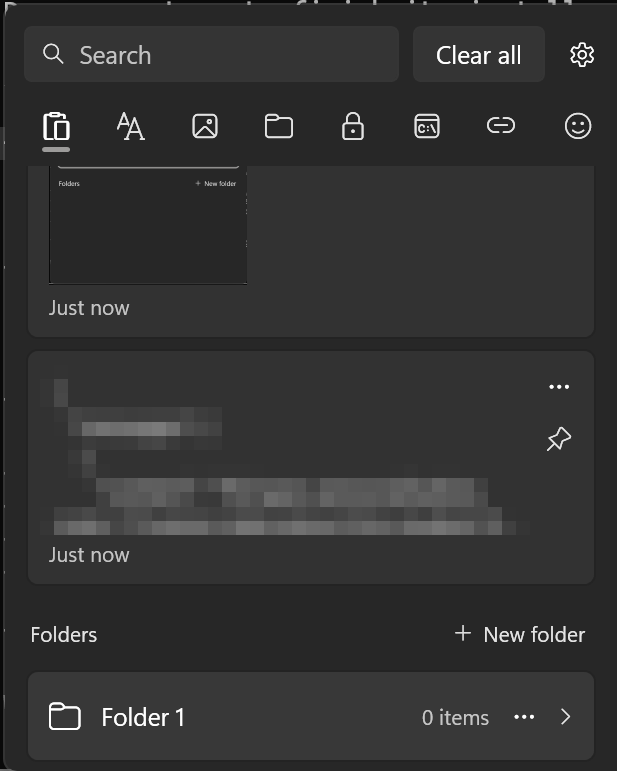
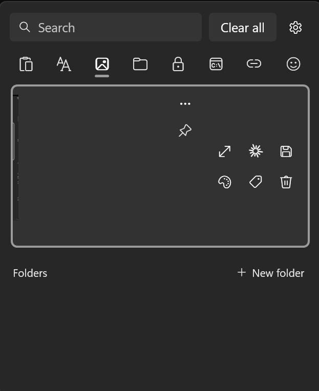
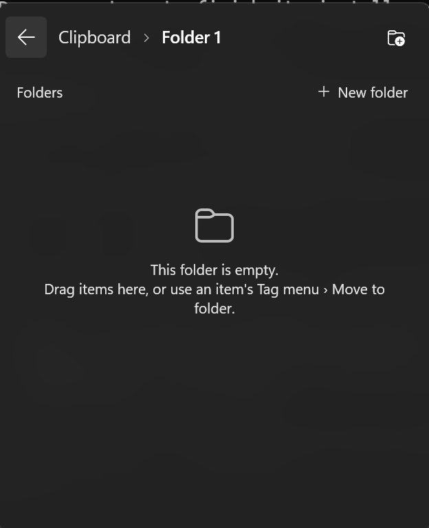

# ClipVault

A clipboard history for Windows 11 that looks and works like the built-in **Win+V** panel, without its limits.

- **No 4 MB limit.** Full-screen and multi-monitor screenshots are kept.
- **Large history** (500 items by default, adjustable) that survives restarts.
- **Text, images, files and folders.** Ctrl+C in Explorer is saved too, and pasting it later copies the files again.
- **Pin and tag.** Click the pin on any card to pin it (click again to unpin) so it's never removed. Create your own tags (e.g. `CMDS`) and pin items into them, and each tag gets its own tab.
- **Search** and **All / Text / Images / Files** tabs.
- **Emoji picker** with full-color Windows emoji, search and recently used.
- **Card actions.** Click **⋯** on a card to slide out:
  - **Ask Claude**: sends the item to your latest Claude Code conversation (`claude --continue "<item>"`)
  - **Paste as plain text** (text), **Save as…** (images), **Open location** (files)
  - **Tag** (pin into one of your tags), and **Delete**
- **Clear all** removes everything except pinned items.
- **Opens at your text cursor**, found the way Windows does it (UI Automation), in Chrome, VS Code, Terminal, Office and classic apps.
- **Size** setting (100-150%) to make text and the popup bigger.
- Follows Windows **light/dark mode** and **accent color**, with the Windows 11 acrylic backdrop.
- **Sync between PCs** (optional): pinned text, tags and folders with an account, optionally end-to-end encrypted. Manual **Push** / **Pull** with a preview; the newer change wins.
- **Private.** No telemetry, and no network access unless you set up Sync and press Push or Pull. Everything else stays in `%LOCALAPPDATA%\ClipVault`.

## Screenshots

| History, pinned items and folders | Card actions | Inside a folder |
| :---: | :---: | :---: |
|  |  |  |

## Usage

| Key | Action |
| --- | --- |
| **Win+V** | Open the history (next to your text cursor) |
| **Enter** / click | Paste the selected item |
| **Shift+Enter** | Paste as plain text |
| **↑ ↓** | Move through items |
| Type anything | Search |
| **Delete** | Delete the selected item |
| **Menu key** | Show the actions for the selected item |
| **Esc** / click outside | Close |

Right-click the tray icon for **Pause saving**, **Settings** and **Exit**.

### How Win+V is taken over

ClipVault catches Win+V with a keyboard hook while it runs, the same technique Microsoft PowerToys uses.
**No Windows settings or registry keys are changed for this.** When ClipVault exits, Win+V opens the Windows panel again.
The only registry entry ClipVault writes is the optional *Start with Windows* entry in `HKCU\...\Run`.

### Privacy

ClipVault skips clipboard content that apps mark as private (password managers use
`ExcludeClipboardContentFromMonitorProcessing` / `CanIncludeInClipboardHistory = 0`), just like Windows does.

## Sync between PCs (optional)

Sync copies your **pinned text items, tags (with built-in icons) and folders** between your PCs.
Images, files, unpinned history and settings stay on each PC. It's **off by default**, and nothing is sent until you press **Push** or **Pull**.

1. **Win+V → ⚙ → Sync between PCs** (switch it on).
2. **Create account** with your email and a password (first PC), or **Sign in** (other PCs).
3. On the first PC, choose an **encryption passphrase**, or leave it empty:
   - **With a passphrase**, everything is encrypted on your PC before upload (AES-256, key derived from the passphrase with PBKDF2-SHA256). Nobody else can read it, including the server's owner. Other PCs ask for the passphrase once. It can't be recovered if you forget it.
   - **Without one**, data is stored compressed but readable on the server.
   - You can turn encryption on or change the passphrase later; what's in the cloud is re-uploaded in the new mode.
4. **⬆ Push** sends this PC's changes; **⬇ Pull** brings in the cloud's. Both show what will change first.

When the same item changed on two PCs, **the newer change wins**. Unpinning an item unpins it on the other PCs (it stays in their history); deleting deletes.
**Unlink this PC** stops syncing this PC and forgets the account (your items stay; the cloud and other PCs are untouched).
**Delete account** (in the same card) removes your account and everything it stored.

## Install

**Download `ClipVault.exe` from the [latest release](https://github.com/arafeh94/ClipVault/releases/latest) and run it.** That's it:

- It installs itself to `%LOCALAPPDATA%\Programs\ClipVault` (no admin rights), starts with Windows and takes over Win+V.
- Running a newer `ClipVault.exe` later updates it in place; your history and settings are kept.
- It isn't code-signed, so the first time Windows may show *"Windows protected your PC"*: click **More info → Run anyway**.
- To uninstall: right-click the tray icon → **Uninstall ClipVault…** (you can keep or delete your history).
- Needs Windows 10/11 with .NET Framework 4.8 (built into Windows 10 1903+ and Windows 11).

### Build from source

No SDK needed. It builds with the C# compiler and .NET Framework 4.8 that ship with Windows:

```powershell
git clone https://github.com/arafeh94/ClipVault
cd ClipVault
powershell -ExecutionPolicy Bypass -File install.ps1     # build, install, start with Windows, take over Win+V
```

Uninstall a source install with `powershell -ExecutionPolicy Bypass -File uninstall.ps1` (your history is kept; add `-RemoveData` to delete it too).
To only build, run `build.ps1`; the output is `bin\ClipVault.exe`. Run it with `--portable` to try it without installing.

AI agents: see [AGENTS.md](AGENTS.md).
## Project layout

| File | What it does |
| --- | --- |
| `src/App.cs` | Startup, single instance, tray icon, settings window |
| `src/ClipboardService.cs` | Watches the clipboard, reads/writes text, images and files |
| `src/HotkeyHook.cs` | Win+V keyboard hook |
| `src/Store.cs` | History on disk (`index.json` + one file per image) |
| `src/PopupWindow.cs` | The popup: list, tabs, actions, emoji, paste |
| `src/Emoji.cs` | Color emoji rendering through Direct2D/DirectWrite |
| `src/Theme.cs` | Light/dark, accent color, icons, Ask Claude launcher |
| `src/*.xaml` | Styles and layout |

## License

MIT
